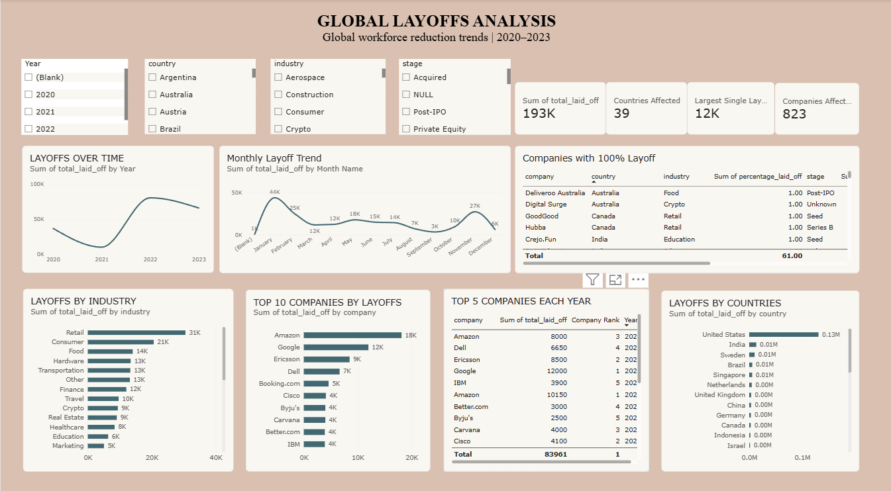

# Global Layoffs Analysis | SQL & Power BI

## Project Overview

This project analyses global workforce reductions between 2020 and 2023 using MySQL and Power BI. The objective is to clean and prepare layoff data, perform exploratory data analysis, identify trends and patterns, and present key findings through an interactive Power BI dashboard.

The project demonstrates an end-to-end data analysis workflow, from raw data preparation and SQL analysis to business intelligence and visualization.

## Dashboard Preview



## Tools & Technologies

- **MySQL** – Data cleaning and exploratory data analysis
- **Power BI** – Data visualization and dashboard development
- **Power Query** – Data transformation and preparation
- **CSV** – Dataset storage

## Dataset

The dataset contains information about company layoffs, including:

- Company
- Location
- Industry
- Total employees laid off
- Percentage of workforce laid off
- Date
- Company funding stage
- Country
- Funds raised (millions)

Two CSV files are included:

- `layoffs.csv` – Original dataset containing 2,361 records.
- `layoffs_cleaned.csv` – Cleaned dataset containing 1,000 records, used for further analysis and Power BI visualization.

## Project Workflow

### 1. Data Cleaning – MySQL

Performed data cleaning using MySQL to improve data quality and consistency.

Key operations:

- Created staging tables to preserve the original dataset.
- Identified duplicate records using `ROW_NUMBER()` and removed them.
- Standardized company names using `TRIM()`.
- Standardized industry categories, including Crypto-related industries.
- Cleaned country names by removing unwanted characters.
- Converted date values from text into the proper DATE format using `STR_TO_DATE()`.
- Replaced blank industry values with NULL.
- Handled missing industry values using self-joins.
- Removed records where both `total_laid_off` and `percentage_laid_off` were NULL.
- Dropped the temporary `row_num` column.

### 2. Exploratory Data Analysis – MySQL

Performed exploratory analysis to identify patterns and trends in global layoffs.

Analysis included:

- Identifying the maximum number of layoffs.
- Finding companies that laid off 100% of their workforce.
- Analysing total layoffs by company.
- Analysing layoffs by industry and country.
- Examining yearly and monthly layoff trends.
- Calculating rolling monthly layoff totals using window functions.
- Identifying the top five companies with the highest layoffs each year using `DENSE_RANK()`.

**SQL concepts used:**

- Aggregate functions
- GROUP BY and ORDER BY
- Common Table Expressions (CTEs)
- Window functions
- ROW_NUMBER()
- DENSE_RANK()
- Self-joins
- String and date functions

### 3. Data Transformation – Power BI

Imported the cleaned CSV dataset into Power BI and performed additional transformations using Power Query.

Key transformations:

- Promoted the first row to column headers.
- Assigned appropriate data types to columns.
- Extracted the year from the date column.
- Created a Month Name column.
- Created a Month Number column to support chronological sorting of months.

### 4. Dashboard Development – Power BI

Developed an interactive dashboard titled **Global Layoffs Analysis – Global Workforce Reduction Trends | 2020–2023**.

**Dashboard KPIs:**

- Total Layoffs: 193K
- Countries Affected: 39
- Largest Single Layoff: 12K
- Companies Affected: 823

**Visualizations:**

- Layoffs Over Time
- Monthly Layoff Trend
- Companies with 100% Layoff
- Layoffs by Industry
- Top 10 Companies by Layoffs
- Top 5 Companies Each Year
- Layoffs by Countries

**Interactive Filters:**

- Year
- Country
- Industry
- Company Stage

## Key Insights

Based on the Power BI dashboard:

- Approximately 193K layoffs were recorded across 39 countries.
- A total of 823 companies were affected.
- The largest single layoff recorded was approximately 12K employees.
- Retail recorded the highest layoffs by industry, followed by Consumer and Food.
- The United States recorded the highest number of layoffs among the countries displayed.
- Amazon, Google and Ericsson were among the companies with the highest layoffs.

## Repository Structure

```text
Global-Layoffs-Analysis-SQL-PowerBI/
│
├── Dataset/
│   ├── layoffs.csv
│   └── layoffs_cleaned.csv
│
├── SQL/
│   ├── data cleaning.sql
│   └── exploratory data analysis.sql
│
├── Power BI/
│   └── project visualization dashboard.pbix
│
├── dashboard.png
└── README.md
```

## How to Explore the Project

1. Clone or download this repository.
2. Open the SQL files using MySQL Workbench to explore the data cleaning and exploratory analysis queries.
3. Open the Power BI `.pbix` file using Power BI Desktop.
4. If prompted, update the CSV source file path in Power Query to the location of `layoffs_cleaned.csv`.
5. Refresh the data to explore the interactive dashboard.

## Author

**Starlin Pereira**